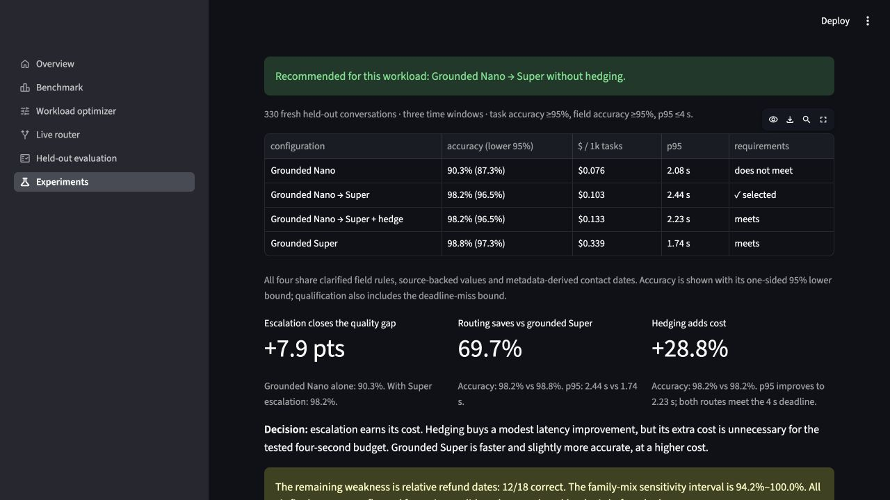

# M5: fresh-data inference confirmation

**Deployment choice: source-grounded Nano → Super, without hedging.** Predeclared grounding-plus-hedging hypothesis: **supported**.

Run `confirmation-20261025T212745Z-ac61b1`; 330 unique held-out conversations, nine independent live arms, three time windows, plus repeated sentinel conversations. The fixed comparator `fixed_super` was frozen before test. The original v1 result remains unchanged.

| Configuration | Task acc. | Lower 95% | p95 | $ / 1k |
|---|---:|---:|---:|---:|
| Grounded Nano | 90.3% | 87.3% | 2.08 s | $0.076 |
| Grounded Nano → Super | 98.2% | 96.5% | 2.44 s | $0.103 |
| Grounded Nano → Super + hedge | 98.2% | 96.5% | 2.23 s | $0.133 |
| Grounded Super | 98.8% | 97.3% | 1.74 s | $0.339 |

Cheapest qualifying fixed model on heldout (descriptive): **Grounded Super**. Qualification requires task-accuracy lower bound ≥95%, field accuracy ≥95%, deadline-miss upper bound ≤5% at four seconds, and complete cost accounting. Wilson bounds assume independent binomial outcomes. Shared templates and provider stalls can violate that model; per-family/window results are sensitivity checks, not a production SLO certificate. These bounds describe this accepted synthetic workload; they are not a guarantee for arbitrary customer data.

At one million tasks of these measured token lengths, the selected configuration projects to $102.91, versus $339.47 for the cheapest qualifying fixed model: a $236.56 difference. Infrastructure and development costs are excluded.

The selected unhedged route was already the cheapest qualifying tuning choice and also clears the held-out gates. It costs **69.7% less than matched grounded Super**, with observed task accuracy **98.2% versus 98.8%**. This is not evidence of one-point non-inferiority. Hedging adds **28.8%** cost; it is optional under these measured latency conditions.

## What the useful comparisons show

- **Escalation earns its cost:** grounded Nano alone reaches 90.3% task accuracy; adding Super escalation reaches 98.2%.
- **Routing is the lower-cost qualifying choice:** $0.103 versus $0.339 per 1,000 tasks for grounded Super. The tradeoff is 98.2% versus 98.8% accuracy and 2.44 s versus 1.74 s p95; one-point non-inferiority was not established.
- **Hedging is optional at this deadline:** it lowers p95 from 2.44 s to 2.23 s but adds 28.8% cost. Both routes meet the four-second budget and have the same observed accuracy.

All four use the same grounded extraction treatment. Original-prompt controls and the formal primary comparison are retained in the expanded study details below.

## Remaining errors

All six primary errors from the selected route are refund-date errors in the relative-date family. Super answered these after escalation, and the deterministic validator still flagged the final output. The two-call limit was retained. The interface marks such requests for review; the experiment counts them as incorrect. The relative-date family scored **12/18 correct (66.7%)**. Its error concentration makes workload mix material: the selected route's family-cluster sensitivity interval is **94.2–100%**, crossing the 95% target even though the declared unique-conversation Wilson gate passes. No rules were patched on this exposed test set. A future date-normalization or reasoning-backup experiment needs new test conversations.

## Data validity and scope

422/440 writer outputs passed deterministic verification; one was subsequently dropped in blinded label review. Labels were never edited to match model answers. Order references and issue dates are explicitly bound in the source. Arrival-only cases have null issue dates; distinct issue/arrival cases test their separation.

M5 reviews every verifier disagreement before Nano production inference. Explicit issue statements and arrival-only negatives test the event distinction rather than treating every date as interchangeable.

The prose is model-written, and the reviewer is a coding agent. Explicit fact statements improve label defensibility but reduce linguistic diversity. Human/domain review, real customer data and multi-day serving measurements remain outstanding external-validation work. Three same-day windows do not establish production availability.

## Serving and accounting

Priced API usage for M5: **$2.372**, including generation/verification ($1.382), tuning ($0.163) and every confirmation arm ($0.827). Original verifier transport failures: 7; unresolved after bounded retries: 0. Failed 529 responses have no reported token usage; known priced usage is not a reconciled provider invoice. Production requests with incomplete usage: 0.

Response time is observed at the answer callback, before unused hedge calls finish. All completed calls are included in cost; accounting-completion latency is separately recorded. Every unique request is included, including provider failures. No completed production outcome was replaced.

## Reproduce

```bash
routewise confirmation report --study m6 --run runs/confirmation-20261025T212745Z-ac61b1
python -m pytest
streamlit run app/streamlit_app.py
```

The Workload optimizer page exposes editable requirements, fixed-model comparisons, monthly-cost projections, full traces, source evidence, downloads and a labelled-workload import flow. Changing requirements on recorded test data is exploratory, not a new confirmation experiment.

## Dashboard proof



<details>
<summary>Full study design, all nine configurations and paired comparisons</summary>

| Configuration | Task acc. | Lower 95% | p95 response | Deadline-miss upper 95% | Cost / 1k | Qualifies |
|---|---:|---:|---:|---:|---:|---|
| Nano | 83.3% | 79.7% | 2.06 s | 0.8% | $0.065 | no |
| Grounded Nano | 90.3% | 87.3% | 2.08 s | 0.8% | $0.076 | no |
| Current router | 92.1% | 89.3% | 2.20 s | 0.8% | $0.084 | no |
| Grounding only | 98.2% | 96.5% | 2.44 s | 0.8% | $0.103 | yes |
| Hedging only | 91.2% | 88.3% | 2.20 s | 0.8% | $0.104 | no |
| Grounding + hedging | 98.2% | 96.5% | 2.23 s | 0.8% | $0.133 | yes |
| Super | 92.7% | 90.0% | 1.56 s | 0.8% | $0.291 | no |
| Grounded Super | 98.8% | 97.3% | 1.74 s | 1.3% | $0.339 | yes |
| Ultra | 93.9% | 91.4% | 1.20 s | 0.8% | $1.002 | no |

## Paired secondary comparisons

Grounding + hedging minus each comparator. Accuracy intervals are percentage points; cost intervals are USD per 1,000 tasks. Conversation clusters keep repeated answers together. Ablation comparisons are secondary, with no multiplicity-adjusted superiority claim.

| Comparator | Accuracy difference (95% CI) | Cost difference (95% CI) |
|---|---:|---:|
| Current router | +6.06 (+2.73, +9.39) | +0.048 (+0.035, +0.062) |
| Grounding only | +0.00 (-0.91, +0.91) | +0.030 (+0.017, +0.043) |
| Hedging only | +6.97 (+3.64, +10.30) | +0.028 (+0.015, +0.043) |
| Super | +5.45 (+2.12, +8.79) | -0.159 (-0.171, -0.145) |


The original-prompt controls measure the combined effect of prompt clarification, source constraints and metadata-derived fields. They do not isolate those components individually.

</details>

<details>
<summary>Audit history and complete follow-up spend</summary>

The completed confirmation is displayed as **M5** in the product and submission. Its original preregistered study key is `m6`; protocol filenames, raw run IDs and reproducibility commands retain that identity. The earlier aborted study has the original key `m5` and is not the completed milestone.

The earlier `m5` run was stopped for invalid date labels. Its records are retained in [the audit report](M5-report.md) and the run registry. The completed `m6` study uses new conversations rather than relabelled test data from the aborted study.

## Full follow-up spend

The aborted study (`m5`) used $2.228. The completed confirmation (`m6`, displayed as M5) used $2.372. Total new known priced API usage: **$4.600**. The earlier experiments used approximately $6, accounted separately. Failed overload responses lack token usage; these are published-price estimates, not reconciled invoices.


</details>
